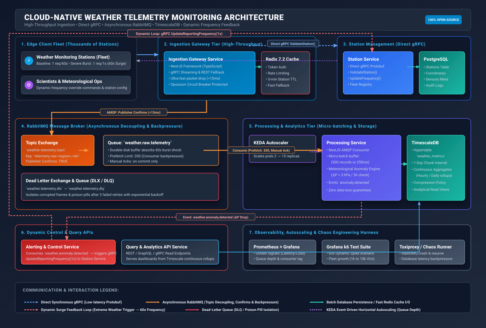

# Cloud-Native Weather Telemetry Monitoring System

[](https://nodejs.org/)
[](https://www.typescriptlang.org/)
[](https://nestjs.com/)
[](https://www.rabbitmq.com/)
[](https://www.timescale.com/)
[](#)

A high-throughput, cloud-native microservices system engineered to ingest, process, and analyze massive volumes of real-time weather telemetry from thousands of edge monitoring stations.

The platform handles **dynamic reporting frequencies** (bursting from standard 60-second intervals to 1-second intervals during severe weather — a **60x surge**) and is resilient against network partitions and infrastructure outages.

---

## 🏛️ System Architecture at a Glance

The architecture employs **dual inter-service communication paradigms**:
1. **Direct Synchronous Communication (gRPC)**: Low-latency, type-safe RPCs across microservices for transactional validations and configuration shifts.
2. **Asynchronous Communication (RabbitMQ)**: Event-driven telemetry streaming with publisher confirms, backpressure flow control, and Dead Letter Queues (DLQ).



> 💡 **Diagram as Code**: The architecture diagram above is generated directly from [`prompt/generate_diagram.py`](file:///home/boris/devspace/weather-monitoring-system/prompt/generate_diagram.py). Whenever architecture changes occur, update the script and run `python3 prompt/generate_diagram.py` to regenerate the SVG image.

---

## 📁 Repository Structure

This project is organized as a NestJS monorepo:

```
weather-monitoring-system/
├── apps/
│   ├── ingestion-service/         # High-throughput gateway (REST :3000 + gRPC :50052)
│   ├── station-service/           # Station metadata registry & gRPC server (:50051)
│   ├── processing-service/        # Worker consuming RabbitMQ -> TimescaleDB micro-batches
│   └── alerting-service/          # Anomaly subscriber -> dynamic frequency commander
├── libs/
│   ├── contracts/                 # Protobuf definitions (.proto) & shared TypeScript interfaces
│   ├── common/                    # AppLogger, Opossum Circuit Breakers, filters, retry
│   └── rabbitmq/                  # AMQP connection lifecycle, publisher confirms, topologies
├── database/timescale/init.sql     # TimescaleDB hypertable partitioning & continuous rollups
├── docs/                          # Detailed developer and architecture guides
│   └── DEVELOPER_GUIDE.md         # Comprehensive developer documentation & runbook
├── infra/prometheus/              # Prometheus metric scraper configurations
├── k8s/autoscaling/               # KEDA ScaledObject & Kubernetes HPA manifests
├── prompt/                        # Master system prompts, design documents, diagram code
├── test/
│   ├── k6/scenarios/              # 60x dynamic spike & fleet scaling load test scripts
│   └── chaos/                     # Fault injection (circuit breaker & DLQ isolation)
└── docker-compose.yml             # Local open-source backing services
```

---

## ⚡ Quick Start

### 1. Prerequisites
- [Node.js](https://nodejs.org/) v20.x or later
- [Docker](https://www.docker.com/) & Docker Compose
- Optional for testing: [k6](https://k6.io/) (load testing), [grpcurl](https://github.com/fullstorydev/grpcurl) (gRPC testing)

### 2. Install Dependencies
```bash
npm install
```

### 3. Start Backing Infrastructure
Launch TimescaleDB, RabbitMQ, Redis, and Prometheus:
```bash
docker compose up -d
```

Verify service availability:
| Service | Host Port | Web UI / Access | Credentials |
| :--- | :--- | :--- | :--- |
| **RabbitMQ Management** | `15672` | [http://localhost:15672](http://localhost:15672) | `guest` / `guest` |
| **RabbitMQ AMQP** | `5672` | `amqp://localhost:5672` | `guest` / `guest` |
| **TimescaleDB / Postgres** | `5432` | `localhost:5432/weather_db` | `postgres` / `postgrespassword` |
| **Redis Cache** | `6379` | `redis://localhost:6379` | *None* |
| **Prometheus** | `9090` | [http://localhost:9090](http://localhost:9090) | *None* |

### 4. Run the Microservices

You can run the microservices concurrently in separate terminal windows:

```bash
# Terminal 1: Station Management Service (gRPC :50051)
npm run start:station:dev

# Terminal 2: Ingestion Gateway Service (HTTP :3000, gRPC :50052)
npm run start:ingestion:dev

# Terminal 3: Processing & Analytics Worker (RabbitMQ consumer)
npm run start:processing:dev

# Terminal 4: Alerting & Dynamic Control Service
npm run start:alerting:dev
```

---

## 🧪 Testing the System

### 1. Send Telemetry via HTTP REST
```bash
curl -X POST http://localhost:3000/api/v1/telemetry \
  -H "Content-Type: application/json" \
  -d '{
    "station_id": "ST-ALPS-001",
    "timestamp": 1728518400000,
    "temperature": 18.5,
    "humidity": 65.0,
    "pressure": 1013.2,
    "wind_speed": 12.0,
    "wind_direction": 180,
    "precipitation": 0.0,
    "api_key": "sec_token_alps_001"
  }'
```
**Response**:
```json
{
  "code": 1,
  "message": "Telemetry successfully ingested and queued for analysis",
  "server_timestamp": 1728518400120
}
```

### 2. Send Telemetry via gRPC (`grpcurl`)
```bash
grpcurl -plaintext -d '{
  "station_id": "ST-ALPS-001",
  "temperature": 21.4,
  "humidity": 58.0,
  "pressure": 1012.0,
  "wind_speed": 8.5,
  "wind_direction": 90,
  "api_key": "sec_token_alps_001"
}' localhost:50052 weather.telemetry.v1.WeatherIngestionService/SubmitTelemetry
```

### 3. Simulate a Severe Weather Anomaly & Dynamic 1s Surge
Send an extreme barometric pressure drop ($\Delta P > 3\text{ hPa}$):
```bash
curl -X POST http://localhost:3000/api/v1/telemetry \
  -H "Content-Type: application/json" \
  -d '{
    "station_id": "ST-ALPS-001",
    "timestamp": 1728518400000,
    "temperature": 15.0,
    "humidity": 88.0,
    "pressure": 1005.0,
    "wind_speed": 34.0,
    "wind_direction": 270,
    "precipitation": 25.0,
    "api_key": "sec_token_alps_001"
  }'
```
*Observe terminal logs:*
1. `processing-service` detects the rapid drop $\rightarrow$ publishes `weather.anomaly.detected`.
2. `alerting-service` consumes the anomaly $\rightarrow$ issues direct gRPC `UpdateReportingFrequency(1s)` to `station-service`.
3. `station-service` updates station sampling interval to **1 second**.

---

## 📊 Performance & Chaos Verification

| Test Suite | Command | What It Validates |
| :--- | :--- | :--- |
| **60x Dynamic Frequency Spike** | `npm run test:k6:spike` | Ingestion latency ($p95 < 50\text{ms}$) under sudden 1,200 req/sec bursts. |
| **Fleet Growth (5,000+ stations)** | `npm run test:k6:growth` | System throughput and memory stability as client fleet expands. |
| **Resilience & Chaos Suite** | `bash test/chaos/run-chaos-suite.sh` | Circuit breaker trip/fallback and DLQ poison pill isolation. |

---

## 📖 In-Depth Documentation

For complete architectural details, practical development conventions, gRPC schemas, database queries, and debugging workflows, refer to the **[Developer Guide](file:///home/boris/devspace/weather-monitoring-system/docs/DEVELOPER_GUIDE.md)**.
