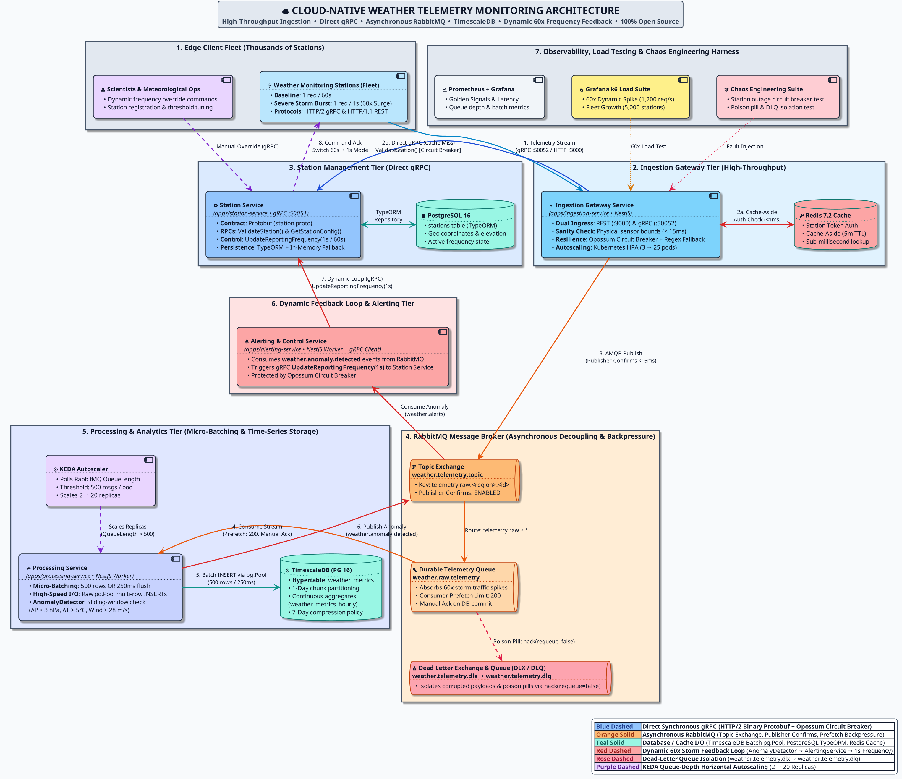
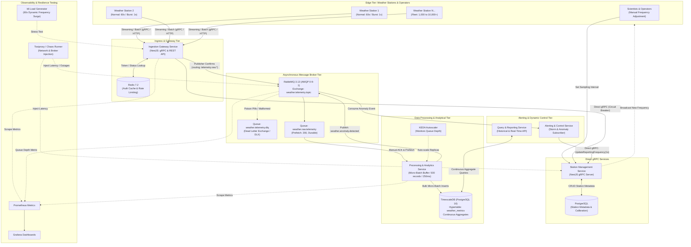
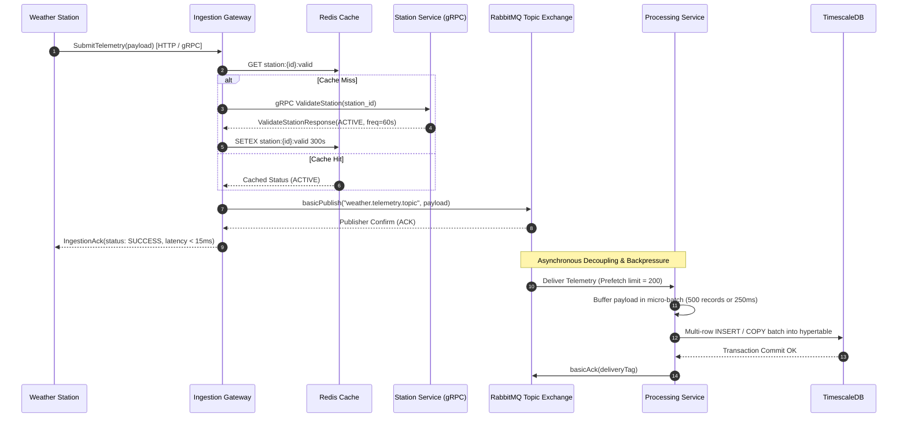
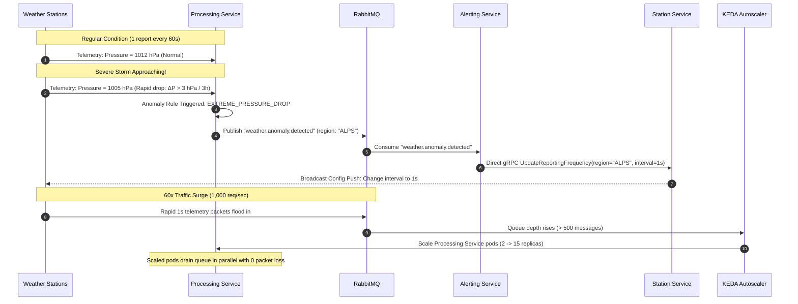
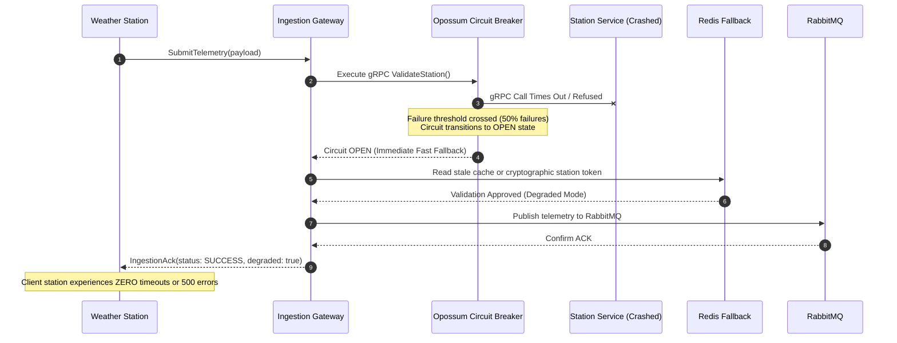

# System Design & Architecture Topology

This document illustrates the complete architectural blueprint for the **Cloud-Native Weather Monitoring System**.

> **Diagram as Code**: The architecture image above is generated directly from [`system-architecture-diagram.puml`](file:///home/boris/devspace/weather-monitoring-system/prompt/system-architecture-diagram.puml) using **PlantUML**. Whenever architecture changes occur in the future, you can update the PlantUML source and run `plantuml -tpng prompt/system-architecture-diagram.puml` (or `npm run diagram:generate`) to re-generate [`system-architecture-diagram.png`](file:///home/boris/devspace/weather-monitoring-system/prompt/system-architecture-diagram.png). Graphviz DOT source is also available at [`system-architecture.dot`](file:///home/boris/devspace/weather-monitoring-system/prompt/system-architecture.dot).

---

## 1. High-Level System Architecture Diagram

---

## 2. Ingestion & Storage Pipeline (Sequence Flow)

---

## 3. Dynamic Frequency Surge Feedback Loop

---

## 4. Resiliency & Failure Degradation (Chaos Flow)

